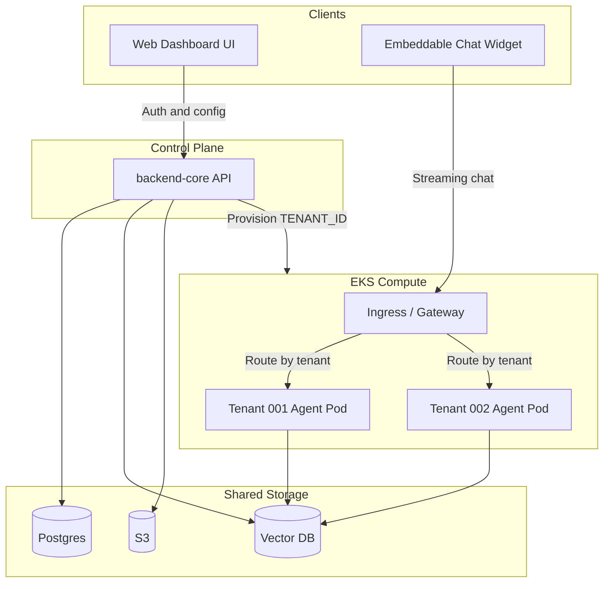

# Product and Architecture Overview

**Purpose:** Define the product and the target production topology.  
**Audience:** Humans and LLMs needing system context before scaffolding or designing features.  
**Status:** Settled (product shape, Phase 1 stack, and Phase 2 target topology). Remaining open items: [open-decisions.md](open-decisions.md).

## Product

Multi-tenant B2B SaaS: AI support agents for small businesses.

| Surface | Who uses it | Role |
| --- | --- | --- |
| Business dashboard | Tenant admins | Create agents, upload docs for RAG, manage auth/config |
| Control plane API | Dashboard + internal services | Auth, subscriptions, tenant provisioning, document ingestion |
| LangGraph agent runtime | End users via widget | Isolated chat/RAG brain per tenant (Phase 2: dedicated pods) |
| Embeddable chat widget | Tenant customers on their sites | Streams chat to the tenant's agent |

## Architectural pattern

- **Shared control plane:** auth, config, ingestion, provisioning.
- **Pooled data:** Postgres (relational) + Qdrant (vectors) partitioned by `tenant_id` (logical isolation).
- **Siloed compute (Phase 2):** one LangGraph agent deployment/pod (or namespace) per tenant on AWS EKS — eliminates noisy-neighbor compute and memory leakage across tenants.
- **Object storage (Phase 2):** AWS S3 for raw documents; Phase 1 uses local filesystem via abstraction.

## Production topology

### Layer responsibilities

1. **Clients** — Dashboard (auth/config) and chat widget (streaming traffic).
2. **Control plane (`backend-core`)** — Auth, subscriptions, tenant provisioning, document ingestion (chunk/embed/upsert).
3. **Shared data** — Postgres for relational rows; separate vector DB (Phase 1: Qdrant) for embeddings — both pooled and filtered by `tenant_id`.
4. **Object storage** — Raw PDFs/docs under tenant-prefixed paths.
5. **Ingress / proxy** — Validates widget API token, routes to tenant agent pod.
6. **Compute (EKS)** — Per-tenant LangGraph agent pods with local checkpointer (SQLite or Redis — open).

## Deployables (monorepo packages)

| Package | Role |
| --- | --- |
| `backend-core` | Control plane API |
| `agent-service` | LangGraph chat/RAG runtime |
| `frontend-dashboard` | Business UI |
| `chat-widget` | Embeddable end-user script |
| `shared-core` | Shared schemas and interface contracts (storage, vector, tenant) |

Canonical directory layout and Phase 1 Compose: [phase1-layout.md](../developer/phase1-layout.md).  
Phased delivery: [phased-delivery-strategy.md](phased-delivery-strategy.md).  
RAG flows: [rag-and-data-flow.md](rag-and-data-flow.md).
